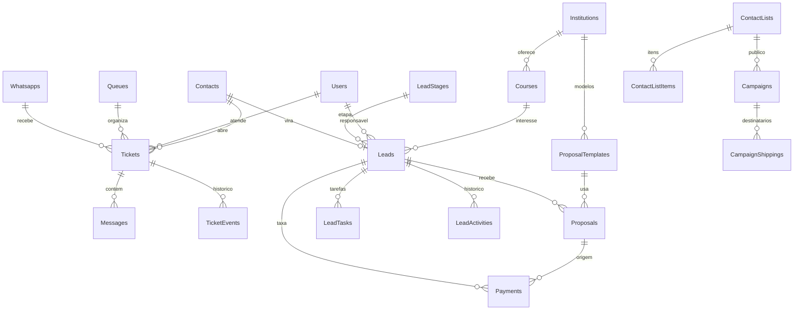

# Banco de dados e publicação (Supabase + Vercel)

## Onde fica cada coisa

| Peça | Onde | Observação |
|---|---|---|
| Telas (React) | **Vercel** | só arquivos estáticos; aponta para a API por `VITE_BACKEND_URL` |
| Banco de dados | **Supabase (PostgreSQL)** | é o único banco; 43 tabelas |
| Arquivos enviados (mídia, PDFs, logos) | pasta `backend/public` no host da API (hoje) → Supabase Storage (próxima etapa) | |
| **API Node (Express + socket.io + workers)** | **um host com processo ligado 24 h** (Railway, Fly.io, Render ou VPS) | **não roda dentro do Supabase** |
| Sessões do WhatsApp (QR Code) | **disco do host da API** (`backend/.wwebjs_auth` ou `.zapo_auth`) | **não ficam no banco**; precisam de volume persistente |

Por que a API não pode ficar no Supabase: as Edge Functions do Supabase são funções curtas (sem processo permanente). O WhatsApp por QR Code precisa de um navegador (Chromium) conectado o tempo todo, o sistema usa WebSocket e tem rotinas em segundo plano (campanhas, lembretes, cobranças). Um host de ~US$ 5–10/mês resolve.

## Passo a passo

1. **Supabase**: crie o projeto → *Project Settings → Database → Connection string*. Use a conexão **direta (porta 5432)** ou o **Session pooler**. Não use o *Transaction pooler* (porta 6543): a trava que impede duas instâncias de abrirem o mesmo WhatsApp precisa de conexão de sessão.
2. **Criar as tabelas** (escolha uma):
   - recomendado: no backend, com `DATABASE_URL` e `DB_SSL=true` no `.env`, rode `npm run db:migrate`;
   - alternativa: cole `supabase/schema.sql` no *SQL Editor* do Supabase (cria tudo, liga a segurança por linha e marca as migrations como aplicadas).
3. **Usuário administrador**: o start roda `scripts/bootstrap-production.js`, que cria o administrador com `ADMIN_EMAIL`/`ADMIN_PASSWORD` (sem elas, com uma senha aleatória mostrada uma única vez no log). Uma senha trocada na tela nunca é desfeita por um deploy; `ADMIN_RESET=true` redefine só em caso de acesso perdido.
4. **API**: suba o backend no host escolhido com as variáveis do `backend/.env.example` (`DATABASE_URL`, `DB_SSL=true`, `JWT_SECRET`, `JWT_REFRESH_SECRET`, `BACKEND_URL`, `FRONTEND_URL`, `APP_TIMEZONE`, `TRUST_PROXY=1`) e **um volume persistente** montado em `backend/.wwebjs_auth` (e `backend/public`). **Uma única réplica.**
5. **Vercel**: importe `frontend/`, defina `VITE_BACKEND_URL` (URL da API) e faça o deploy.
6. **Domínio**: aponte `app.seudominio.com.br` para a Vercel e `api.seudominio.com.br` para o host da API (HTTPS nos dois). Ajuste `FRONTEND_URL=https://app.seudominio.com.br` e `BACKEND_URL=https://api.seudominio.com.br` na API. Como front e API ficam em domínios diferentes, o cookie de renovação do login usa `SameSite=None; Secure` automaticamente quando `BACKEND_URL` começa com `https://` (ou `COOKIE_CROSS_SITE=true`).
7. **Webhooks** (Meta, Efí): usam `https://api.seudominio.com.br/webhooks/...`.

## Backup, teste de restauração e limpeza

- **Backup**: `deploy/vps/backup.sh` (cron noturno) guarda o banco (`pg_dump`) e os arquivos do volume em `/opt/backups`, opcionalmente criptografados e copiados para fora do servidor.
- **Teste de restauração**: `deploy/vps/restore-check.sh` restaura o dump mais novo em um Postgres descartável, confere as tabelas e as contagens (usuários, contatos, mensagens, leads) e apaga tudo no fim. Não toca no banco real. Rode depois de mexer no backup e deixe no cron uma vez por mês (a linha está no cabeçalho do script): backup que nunca foi restaurado não é backup.
- **Restaurar de verdade** (desastre): pare a API (`docker compose stop api`), crie um banco vazio, `pg_restore --no-owner --no-acl -d <banco> <arquivo.dump>` (descriptografe antes com `openssl enc -d -aes-256-cbc -pbkdf2` se o arquivo termina em `.enc`), aponte `DATABASE_URL` para ele e suba a API: as migrações pendentes rodam sozinhas.
- **Limpeza noturna** (`workers/DataRetention.ts`, entre 3 h e 5 h, em lotes): só tabelas que apenas crescem: envios já entregues da fila (120 dias), registros de turnos do agente (180), consumo de IA (400), erros do navegador (60), lembretes enviados (90) e redefinições de senha usadas ou vencidas (30). Conversas, mensagens, leads, tarefas, matrículas e o histórico de atividades nunca são apagados.
- **Índices** das consultas por período e por dono (`20261207000007-hot-path-indexes`): criados sem travar a tabela (`CONCURRENTLY`).

## Segurança do banco

- O Supabase publica as tabelas do schema `public` por uma API REST (chave `anon`). Aqui **todas as tabelas ficam com Row Level Security ligado e sem política**, e as funções `anon`/`authenticated` perdem os privilégios: só o backend (conexão direta com a senha do banco) lê e grava. O backend reaplica isso a cada inicialização, inclusive para tabelas futuras.
- **Nunca** coloque a *service role key* ou a senha do banco no front/Vercel.
- CPF só aparece na ficha detalhada; listas e logs mostram máscara.
- Ative o backup diário do Supabase (planos pagos) ou agende `pg_dump`.
- Horários: tudo é gravado em **UTC**; o fuso da empresa (padrão `America/Porto_Velho`, Rondônia) é aplicado só para exibir e para contar "hoje" (Configurações → Geral).

## Mapa das tabelas

**Atendimento**
- `Users` (equipe; `profile` admin/user), `Queues` (setores/filas), `UserQueues` (quem está em qual fila), `Whatsapps` (conexões/canais: WhatsApp QR, Cloud API, Telegram, Messenger, Instagram, chat web), `WhatsappQueues` (filas de cada conexão).
- `Contacts`, `ContactCustomFields`, `Tickets` (cada conversa; guarda fila, atendente, status), `Messages`, `TicketEvents` (histórico de transferências/atribuições), `Tags`, `TicketTags`, `ContactTags`, `QuickAnswers`, `Schedules` (mensagens agendadas).
- Automação: `ChatbotNodes` (fluxo de menus), `AiAgents` (agentes de IA), `Campaigns`, `CampaignShippings` (um registro por destinatário), `ContactLists`, `ContactListItems`.
- Conversas: `TicketPins` (fixadas, uma por pessoa); `Tickets.archivedAt` (arquivadas).
- Integração: `ApiTokens`, `Webhooks`, `Settings` (chave/valor: fuso, cadastro público, Efí, CRM…).

**CRM de educação**
- `Leads` (candidato: curso, forma de ingresso, período, CPF, responsável, etapa), `LeadStages` (funil), `LeadActivities` (linha do tempo), `LeadTasks` (tarefas e lembretes), `LeadTags`.
- `Courses` (catálogo com mensalidade bruta, semestres, modalidade), `Institutions`, `ProposalTemplates` (regras de cada modelo de proposta), `Proposals` (proposta emitida, com os números congelados), `Payments` (taxa de matrícula/Efí).

**IA**
- `KbDocuments` (textos, perguntas frequentes, arquivos e páginas da base de conhecimento) e `KbChunks` (trechos de ~200 tokens com índice de busca em português); `AiUsage` (tokens de cada chamada ao modelo). `AiAgents` guarda persona, limites e campos a coletar; `Tickets.aiSummary/aiTurns/aiSlots` guardam o resumo, o número de respostas e os dados que a IA já coletou.

**Polos e matrícula**: `Polos`, `PoloMembers` (quem atua em cada função do polo), `Queues.poloId/role`, `Leads.onboarding*` (ambientação com o tutor).

**Sistema**: `SequelizeMeta` (migrations aplicadas), `WppKeys` (tabela legada de chaves; o provedor atual não grava nela).

## O que o Supabase muda e o que não muda no WhatsApp

**Não muda nada para o WhatsApp.** A sessão do número (o "login" do chip) é guardada em arquivos no disco da API, não no banco. Trocar o banco não repareia o chip, não envia nada ao WhatsApp e não altera a forma como o sistema conversa com ele (a biblioteca, os envios e o ritmo são os mesmos).

O que *pode* derrubar ou prejudicar um chip e como o sistema evita:

| Risco | Proteção |
|---|---|
| Duas cópias da API abrindo o mesmo número (deploy com sobreposição de containers) — o WhatsApp derruba uma das sessões e isso conta contra o chip | **Trava de instância única**: só a instância que obtém um lock no Postgres abre sessões e roda campanhas; a outra só atende a API e assume sozinha se a primeira cair |
| Disco sem volume persistente: cada deploy perde a sessão e exige novo QR Code (pareamentos repetidos são sinal de risco) | Montar volume em `backend/.wwebjs_auth`; no Railway/Render/Fly isso é obrigatório |
| Mudar de servidor/região toda hora | Manter a API sempre no mesmo servidor (de preferência no Brasil) e o celular do chip com internet |
| Respostas instantâneas, rajadas, campanha fria, ignorar "SAIR" | SendGuard: digitando + atraso, ritmo máximo, modo seguro, aquecimento, opt-out, pausa automática |

**Importante, sem promessa falsa:** o WhatsApp por QR Code usa uma API **não oficial**. Nenhum sistema consegue garantir que um chip nunca será bloqueado, e este projeto **não tenta esconder** o uso nem burlar a detecção do WhatsApp — só reduz comportamentos de robô. Para disparos em volume e contato frio, a única opção sem risco é a **WhatsApp Cloud API oficial** (número da empresa com templates aprovados). Use o QR Code só para atendimento receptivo, com um chip que você aceite arriscar.

## Variáveis e volume da API (host com Docker)

A produção atual roda na VPS (veja `docs/VPS-CONTABO.md`). Em qualquer outro host com Docker, o `Dockerfile` da raiz já faz build, migrations e health check:

1. **Volume**: *Settings → Volumes → New Volume*, montar em `/data`. Sem ele a sessão do WhatsApp e os arquivos se perdem a cada deploy (e o chip pede novo QR Code).
2. **Variáveis** (aba *Variables*):

| Variável | Valor |
|---|---|
| `DB_DIALECT` | `postgres` |
| `DATABASE_URL` | string do **Session pooler** do Supabase (*Connect → Session pooler*, porta 5432, usuário `postgres.SEU_PROJETO`) — **não** a conexão direta `db.xxx.supabase.co`, que é só IPv6 e o Railway não alcança |
| `DB_SSL` | `true` |
| `JWT_SECRET`, `JWT_REFRESH_SECRET` | textos longos e aleatórios (obrigatórios em produção) |
| `BACKEND_URL` | URL pública do serviço (`https://….up.railway.app` ou seu domínio da API) |
| `FRONTEND_URL` | URL da Vercel / domínio do app |
| `PUBLIC_URL` | igual a `BACKEND_URL` (webhooks Meta/Efí) |
| `TRUST_PROXY` | `1` |
| `APP_TIMEZONE` | `America/Porto_Velho` |
| `UPLOAD_DIR` | `/data/public` |
| `WWEBJS_AUTH_PATH` | `/data/wwebjs` |
| `ZAPO_AUTH_PATH` | `/data/zapo/state.sqlite` |
| `NODE_ENV` | `production` |

3. **Uma única réplica** (`numReplicas = 1`). Durante o deploy o Railway pode manter a versão antiga ligada por alguns segundos: a trava de instância única impede que as duas abram o WhatsApp ao mesmo tempo.
4. **Banco novo**: o próprio start roda `sequelize db:migrate`. O administrador é criado pelo `scripts/bootstrap-production.js` (veja o passo 3 acima).
5. **Vercel**: projeto com *Root Directory* `frontend`, `VITE_BACKEND_URL=https://sua-api/`.
